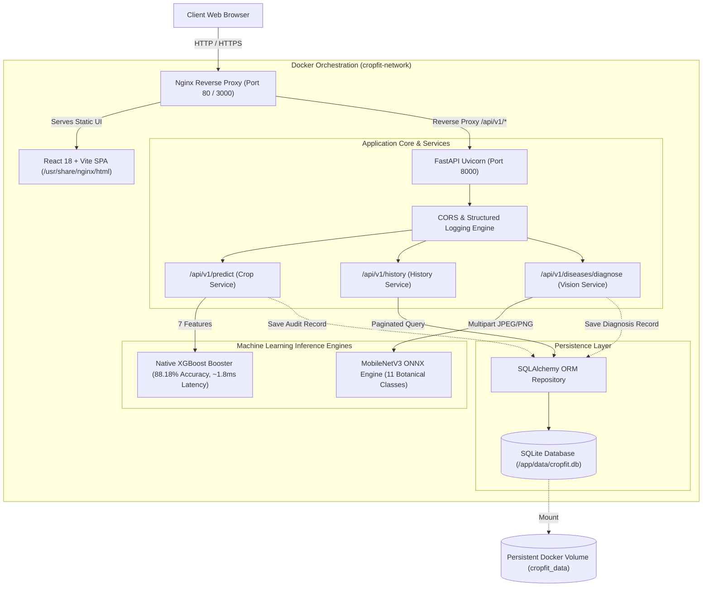

# 🌱 Cropfit — AI-Powered Smart Agriculture Platform

[](https://github.com/jayakaran20/pros/actions/workflows/ci.yml)
[](https://fastapi.tiangolo.com)
[](https://react.dev)
[](https://www.typescriptlang.org)
[](https://xgboost.readthedocs.io)
[](https://onnxruntime.ai)
[](LICENSE)

> **Cropfit** is an enterprise-grade agronomy intelligence platform combining **Tabular Machine Learning (XGBoost)** for precision crop recommendations and **Computer Vision (MobileNetV3 / ONNX)** for real-time plant leaf disease diagnosis. Designed with a clean layered monolith architecture, persistent SQLite audit trails, Nginx reverse proxying, and automated cloud CI/CD quality gates.

---

## 🏛️ System Architecture



---

## ✨ Key Features

1. **Precision Crop Recommendation**:
   * Evaluates 7 soil and climate parameters: Nitrogen ($N$), Phosphorus ($P$), Potassium ($K$), Temperature, Humidity, Soil pH, and Rainfall.
   * Powered by a native C++ **XGBoost Booster** serialized without brittle pickle wrappers, delivering sub-2ms inference ($P95 < 50\text{ms}$).
   * Outputs top-ranked crops with exact probability distributions and agronomic guidance.

2. **Computer Vision Plant Disease Diagnosis**:
   * Supports drag-and-drop multipart upload of smartphone leaf photos.
   * Diagnoses conditions across 11 botanical categories (e.g., Tomato Late Blight, Tomato Early Blight, Potato Healthy Foliage).
   * Returns severity level, primary visual symptoms, organic/chemical treatment plans, and preventative agronomy advice.

3. **Persistent Audit History**:
   * Full database audit trail storing every inference request with input features, timestamps, recommendations, and diagnosis metadata.
   * Filterable and paginated history dashboard with 1-click preset testing.

4. **Production DevOps & Cloud Readiness**:
   * **Multi-Stage Dockerfiles**: Lean runtime containers using non-root security (`appuser`).
   * **Docker Compose**: Single-command stack orchestration (`docker compose up --build`).
   * **GitHub Actions CI**: Automated 3-stage pipeline testing backend, frontend, and container builds.
   * **Automated Smoke Testing**: Built-in Python CLI verification testing all endpoints in $<500\text{ ms}$.

---

## 🚀 Quick Start (Local Development)

### Prerequisites
* **Python 3.11+**
* **Node.js 20+**
* **Git**

### 1. Clone & Setup Repository
```bash
git clone https://github.com/jayakaran20/pros.git Cropfit
cd Cropfit
```

### 2. Backend Setup
```bash
# Create and activate virtual environment
python -m venv .venv
.\.venv\Scripts\activate   # Windows PowerShell
# source .venv/bin/activate  # macOS / Linux

# Install dependencies
pip install -r backend/requirements.txt

# Start the FastAPI server
python -m uvicorn app.main:app --app-dir backend --host 127.0.0.1 --port 8000 --reload
```
API Documentation will be live at: **`http://127.0.0.1:8000/docs`**

### 3. Frontend Setup
In a new terminal window:
```bash
cd frontend
npm install
npm run dev
```
Open your browser at: **`http://localhost:5173`**

---

## 🐳 Running with Docker & Docker Compose

Deploy the entire production stack (Nginx + React SPA + FastAPI + SQLite persistence) with one command:

```bash
docker compose up --build
```

* **Frontend Web Application**: [http://localhost:3000](http://localhost:3000)
* **Backend Swagger API**: [http://localhost:8000/docs](http://localhost:8000/docs)
* **Health Check Probe**: [http://localhost:8000/api/v1/health](http://localhost:8000/api/v1/health)

---

## 🧪 Testing & Verification

### Run Backend Pytest Suite (with Statement Coverage)
```bash
pytest --cov=backend/app --cov-report=term-missing backend/tests/
```
* **Coverage**: **87% statement coverage** across all routes, models, and repositories (22/22 tests passing).

### Run Frontend Vitest Contract Suite
```bash
cd frontend
npm test
```

### Run Automated Production Smoke Tests
```bash
python backend/scripts/smoke_test.py --base-url http://127.0.0.1:8000
```

---

## 📡 REST API Reference

| Method | Endpoint | Description |
|--------|----------|-------------|
| `GET` | `/` | Root service liveness check |
| `GET` | `/api/v1/health` | Comprehensive system health & model memory residency probe |
| `POST` | `/api/v1/predict` | Computes crop recommendations from 7 soil/weather parameters |
| `GET` | `/api/v1/history` | Retrieves paginated prediction and diagnosis audit records |
| `POST` | `/api/v1/diseases/diagnose` | Multipart upload for plant leaf image diagnosis |
| `GET` | `/docs` | Interactive Swagger UI API documentation |
| `GET` | `/redoc` | ReDoc API documentation specification |

---

## 📦 ML Model Governance & Cards

* [XGBoost Crop Recommendation Model Card](file:///C:/Users/TICKMARKS/OneDrive%20-%20tickmarks.net/Desktop/Cropfit/docs/models/crop_recommendation_card.md)
* [Computer Vision Disease Diagnosis Model Card](file:///C:/Users/TICKMARKS/OneDrive%20-%20tickmarks.net/Desktop/Cropfit/docs/models/plant_disease_vision_card.md)

---

## 👤 Author & License

* **Author**: Jayakaran ([@jayakaran20](https://github.com/jayakaran20)) — `jayakaran546@gmail.com`
* **Repository**: [https://github.com/jayakaran20/pros](https://github.com/jayakaran20/pros)
* **License**: MIT
