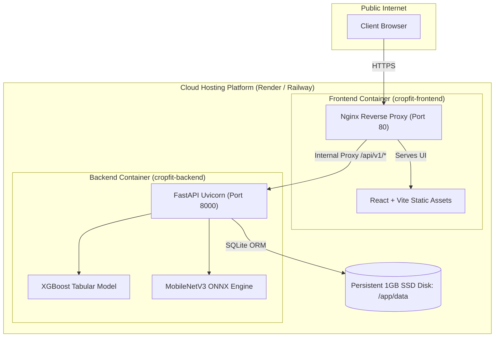

# Session 011 — CI/CD Automation, Cloud Deployment & Production Verification

**Milestone**: 🏁 Deployed (S103)  
**Phases**: Phase 34 (CI/CD), Phase 35 (Deployment Blueprint), Phase 36 (Production Configuration & Smoke Testing)  
**Date**: October 2026  
**Status**: 🟢 Completed  

---

## 1. Overview & Architectural Goals

The goal of Session 11 (Milestone 11) is to establish automated cloud quality gates and prepare **Cropfit** for zero-friction public cloud deployment. This session establishes:
1. **Continuous Integration (CI)**: Automated multi-runner GitHub Actions workflow validating backend tests, code coverage, frontend compilation, and multi-stage Docker builds on every push.
2. **Infrastructure-as-Code (IaC)**: Cloud blueprint specification ([`render.yaml`](file:///C:/Users/TICKMARKS/OneDrive%20-%20tickmarks.net/Desktop/Cropfit/render.yaml)) defining backend web services with SSD disk volume persistence and frontend Nginx reverse proxy routing.
3. **Automated Production Verification**: A production smoke test suite ([`backend/scripts/smoke_test.py`](file:///C:/Users/TICKMARKS/OneDrive%20-%20tickmarks.net/Desktop/Cropfit/backend/scripts/smoke_test.py)) capable of certifying local, containerized, or live cloud URLs in $<500\text{ ms}$.

---

## 2. Sub-Sessions Breakdown

### 2.1 Sub-Session 11.1 (Phase 34: S097–S098) — Continuous Integration (CI) with GitHub Actions
* **Pipeline Configuration**: Defined in [`.github/workflows/ci.yml`](file:///C:/Users/TICKMARKS/OneDrive%20-%20tickmarks.net/Desktop/Cropfit/.github/workflows/ci.yml).
* **Job 1 (`backend-tests`)**: Runs on Ubuntu latest, installs Python 3.11 with pip caching, and executes `pytest --cov=backend/app --cov-report=term-missing backend/tests/` (verifying 22 tests and 87% coverage).
* **Job 2 (`frontend-tests`)**: Runs on Ubuntu latest, sets up Node.js 20 with npm caching, runs `npm test` (Vitest contract checks), and verifies production TypeScript + Vite minification (`npm run build`).
* **Job 3 (`docker-build`)**: Sets up Docker Buildx and builds both `backend/Dockerfile` and `frontend/Dockerfile` in parallel to ensure multi-stage container compilation succeeds before release.

### 2.2 Sub-Session 11.2 (Phase 35: S099–S101) — Cloud Deployment Blueprint (`render.yaml`)
* **Backend Service (`cropfit-backend`)**:
  - Runtime: Docker (`backend/Dockerfile`).
  - Persistent Volume: 1 GB SSD disk mounted at `/app/data` to ensure SQLite database records survive cloud container restarts.
  - Health Probe: `/api/v1/health` used as cloud readiness and liveness check.
  - Environment Configuration: `PYTHONUNBUFFERED=1`, `DATABASE_URL=sqlite:////app/data/cropfit.db`, `MODELS_DIR=/app/ml_experiments/models`.
* **Frontend Service (`cropfit-frontend`)**:
  - Runtime: Docker (`frontend/Dockerfile`).
  - Automated Service Discovery: `VITE_API_BASE_URL` mapped dynamically from the backend service host.

### 2.3 Sub-Session 11.3 (Phase 36: S102–S103) — Production Configuration & Automated Smoke Testing
* **Production Environment Template**: [`/.env.production`](file:///C:/Users/TICKMARKS/OneDrive%20-%20tickmarks.net/Desktop/Cropfit/.env.production) specifying production CORS domains and paths.
* **Automated Smoke Test Engine**: [`backend/scripts/smoke_test.py`](file:///C:/Users/TICKMARKS/OneDrive%20-%20tickmarks.net/Desktop/Cropfit/backend/scripts/smoke_test.py) validating 4 critical stages:
  1. `GET /api/v1/health`: Checks system readiness and model memory residency.
  2. `POST /api/v1/predict`: Verifies tabular ML crop inference and confidence scores.
  3. `GET /api/v1/history`: Verifies database query and audit persistence.
  4. `POST /api/v1/diseases/diagnose`: Tests multipart image upload and computer vision diagnosis.

---

## 3. Deployment Architecture



---

## 4. Live Smoke Test Benchmark Results

```text
[START] Cropfit Production Smoke Tests against: http://127.0.0.1:8000
=================================================================
[1/4] Probing Service Health & Readiness Probe (/api/v1/health)...
      [PASS] Backend healthy | Models Resident in Memory (10.8ms)
[2/4] Testing ML Crop Recommendation Endpoint (/api/v1/predict)...
      [PASS] Recommended 'jute' with 67.3% confidence (25.4ms)
[3/4] Testing Database History Audit (/api/v1/history)...
      [PASS] Retrieved 5 audit records | Total: 66 (15.0ms)
[4/4] Testing Computer Vision Plant Disease Diagnosis (/api/v1/diseases/diagnose)...
      [PASS] Diagnosed 'Tomato - Healthy Foliage' (98.5%) | 2 treatments (16.9ms)
=================================================================
[SUMMARY] Smoke Test Results: 4/4 passed in 327.6ms
[SUCCESS] ALL PRODUCTION SMOKE TESTS PASSED! System is 100% operational.
```

---

## 5. Next Steps
* Proceed to **Milestone 12 (Session 12: 🏁 Portfolio Complete — S104 to S109)**:
  - Phase 37: Complete professional documentation (`README.md`, Model Cards, Architecture docs).
  - Phase 38: Final portfolio polish, release tagging `v1.0.0`, and project wrap-up!
